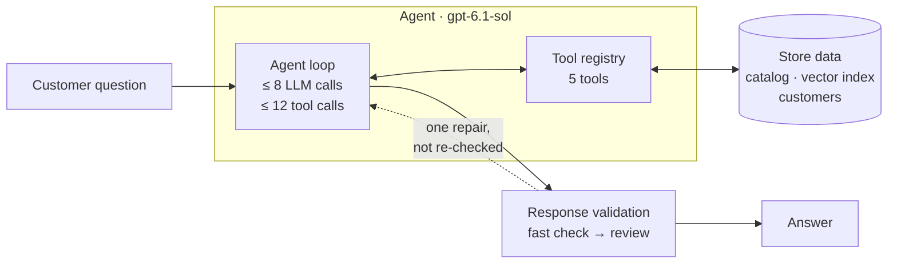
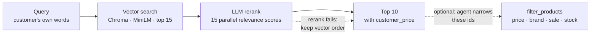
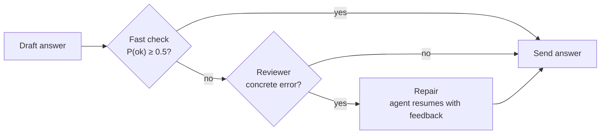

<div align="center">

<h1>🛒 Customer Service Agent</h1>

**An AI shopping agent that grounds every answer in the catalog and checks itself before replying.** It answers customer questions about a Walmart product catalog, finds the right products, and quotes the price *this* customer pays.


</div>

---

## Overview

Customers ask things like *"a scale under $100 that shows pounds and kilograms"* or *"will this purchase make me a premier member?"*. An LLM on its own will guess prices, invent products and get the math wrong.

Facts come from tools. Prices are computed in code, and other arithmetic goes through a calculator tool. A second model reviews the answer before the customer sees it. This is part of a university project on agentic RAG.

- **Prices the model can't fake.**
  - Only a verified sign-in as a premier customer turns on the 5% discount, and that happens in code.
  - The model can't grant the discount itself, even if a customer asks it to.
  - Every product the agent sees already carries its final `customer_price`.
- **Hybrid retrieval.** Semantic search with an LLM reranker handles fuzzy needs. A deterministic filter handles hard constraints: price, brand, sale and stock.
- **Bounded agent loop.**
  - The agent model gets at most 8 calls and 12 tool calls per question.
  - The last call is reserved, so a question always ends with an answer.
- **Self-checking answers.**
  - One fast LLM call scores each answer.
  - A reviewer LLM looks only at answers that score low.
  - A confirmed error gets one repair pass.
- **Errors are data, not crashes.** Tools never raise. Bad arguments come back to the model as `{"error": ...}`, so it can correct itself.

| Layer | Stack |
|---|---|
| **Agent** | OpenAI Responses API · `gpt-6.1-sol` · function calling |
| **Rerank & fast check** | OpenAI Decisions API · `gpt-6-luna` · a probability for each answer |
| **Reviewer** | OpenAI Responses API · `gpt-6-luna` · structured output (pydantic) |
| **Retrieval** | ChromaDB (cosine HNSW) · `all-MiniLM-L6-v2` embeddings, run locally |
| **Data** | Pydantic v2 · mongomock (pymongo API) · Walmart product dataset from Kaggle |
| **Quality** | pytest with hand-written fake OpenAI clients · per-question traces in `agent.log` |

---

## Architecture



**Life of a question:** fresh session → agent calls tools (often several in one turn) → draft answer → fast check / review / ≤ 1 repair → full trace in `agent.log`.

---

## Agent & tools

| Tool | What it does |
|---|---|
| `authenticate` | Checks email and password, then marks the session premier or regular |
| `get_customer` | Looks up a customer by email or name. Returns only their name and product interests (for gift ideas) |
| `search_products` | Semantic product search: retrieve, rerank, return the top 10 |
| `filter_products` | Exact constraints combined with AND: price range, brand, name, on sale, in stock, or a list of ids |
| `calculator` | Safe arithmetic, parsed from the syntax tree with no `eval`. Rounds half-up with `Decimal` |

### Design decisions

- **Pricing lives in code, not in the prompt.**
  - Only a successful `authenticate` call can turn on the discount.
  - Tool arguments are pydantic models that reject unknown fields, so an injected `status="premier"` is refused.
  - A new session per question means one customer's discount can never leak into the next question.
- **Budget edge cases.** When the budget runs out, the agent must answer with what it has (`tool_choice="none"`). Calls past the limit inside a batch still get an error result, so the transcript stays valid.
- **Stateless, resumable runs.**
  - Nothing is stored on OpenAI's side (`store=False`).
  - The client keeps the full transcript, including the encrypted reasoning, so the repair pass can resume the exact run.
- **Testable by design.** Every OpenAI client is passed in as an argument, so the tests use fake clients and never call the API.

---

## Product search



### Design decisions

- **Retrieve cheaply, judge precisely.**
  - A local embedding model finds 15 candidates at no API cost.
  - Each candidate is scored by the probability that it meets the customer's need. All 15 calls run in parallel, so a search takes about as long as one call.
  - Candidates are re-sorted by that score, and ties keep their vector-search order.
- **Meaning and exact rules stay apart.** Embeddings handle price and brand poorly, so those go to `filter_products`. It takes the search results' ids and keeps their relevance order.
- **Embedding text built for a small model.**
  - Product text is laid out as name → category → description, because MiniLM cuts off long input.
  - The Walmart disclaimer is stripped first; it appears in 783 of 787 descriptions.
- **Self-managing index.**
  - The vector collection is named after a hash of the embedded text and the product ids. Changing that text rebuilds the index; otherwise the index is reused from disk.
  - An interrupted build finishes on the next start.

---

## Response validation



### Design decisions

- **Fast gate, careful judge.**
  - An answer that passes costs one extra fast call. Only doubtful answers reach the reviewer.
  - The reviewer sees *every* product that was retrieved, so it can catch a better match the agent skipped.
- **The agent fixes the answer; the reviewer only diagnoses.** The repair resumes the agent's own transcript with its tools, session and remaining budget, instead of having another model rewrite the text.
- **Fails open.** Any error during validation keeps the original answer, so the customer always gets a reply.
- **Capped runs skip validation.** A run that hit the budget is sent as is, because no budget is left to repair it.

---

<details>
<summary><b>Getting started</b></summary>

**Requirements:** Python 3.10+ and an OpenAI API key. Set it as both `OPENAI_API_KEY_AGENT` and `OPENAI_API_KEY_DECISIONS`; they can be different keys if you want separate billing.

```sh
python -m venv .venv && source .venv/bin/activate
pip install -r requirements.txt

python assignment_prep/fetch_product_data.py   # download and curate the product catalog
python assignment_prep/prepare_dataset.py      # check that the data files are ready

cat > .env <<'EOF'
OPENAI_API_KEY_AGENT=sk-...
OPENAI_API_KEY_DECISIONS=sk-...
EOF

python hw4.py "Which scales under \$100 show both pounds and kilograms?"
python run_example_queries.py q3 q10           # run sample queries from example_queries.txt by id
pytest
```

- **First run.** The first run downloads the MiniLM embedding model and embeds the catalog into `chroma_data/`, so it takes a moment. Later runs reuse the index.
- **Traces.** Each question's full trace is written to `agent.log`.
- **Tests.** The tests never call OpenAI. Some of them need `product_data.csv` and the embedding model.

**Repository map**

```
hw4.py                  entry point: answer_question(question) -> str
orchestration/          runtime, agent loop, system prompt, tool registry, response validation, logging
tools/                  authenticate, get_customer, calculator, filter_products, search_products/
pricing/                per-question session and customer pricing
data_init/              product catalog, Chroma index, customer store
assignment_prep/        dataset download and checks
tests/                  pytest suite with fake OpenAI clients
```

</details>

---

<div align="center">

Built by **Shachar Ben Zur** · [GitHub](https://github.com/shachar-bz)

</div>
