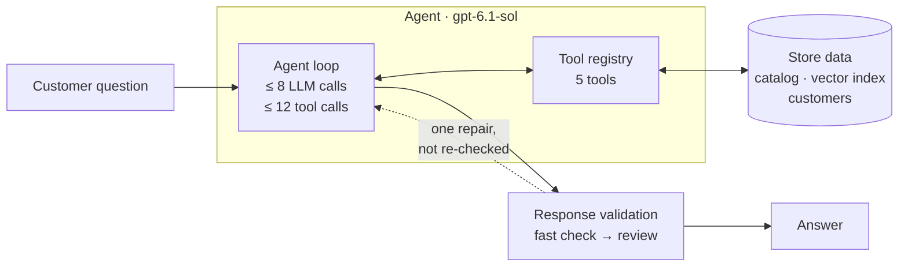
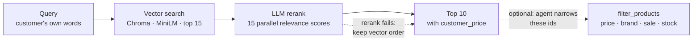
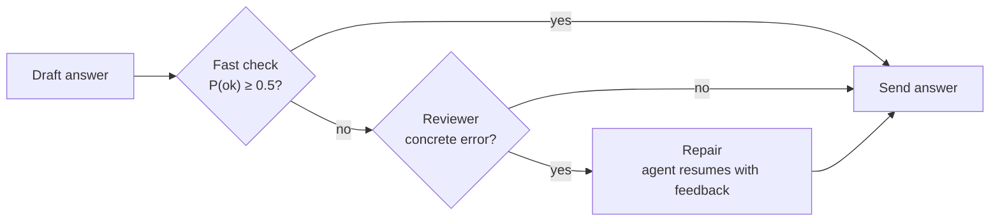

<div align="center">

<h1>🛒 Customer Service Agent</h1>

**An AI shopping agent that grounds every answer in the catalog and checks itself before replying.**


</div>

---

## Overview

The agent answers free-text questions from shoppers, such as *"a scale under $100 that shows pounds and kilograms"* or *"will this purchase make me a premier member?"*. The questions are about a Walmart product catalog, and everything goes through one function: `answer_question(question) -> str`.

**How it answers:**
1. A tool-calling loop on `gpt-6.1-sol` picks the tools it needs.
2. It feeds each tool result back to the model until the model can answer.
3. A fast LLM check scores the answer.
4. A doubtful answer goes to an LLM reviewer. If the reviewer confirms an error, the agent gets one chance to fix it.

It is part of a university project on agentic RAG.

**Key design points:**

- **Lazy loading.**
  - `import hw4` loads nothing heavy.
  - The catalog, the vector index and the OpenAI clients are built on the first question.
  - A test checks this in a clean subprocess.
- **Built once, kept in memory.**
  - The runtime is cached with `functools.cache`, so only the first question pays the startup cost.
  - A failed build is not cached, so the next question tries again.
  - The vector index is saved to disk under a hash of its content, so a restart skips re-embedding.
- **Decisions API for quick judgments.** OpenAI's Decisions API is fast and cheap. It returns a probability instead of text to parse, so it handles the small yes/no and multiple-choice calls:
  - **Reranking:** each search candidate gets one yes/no question, *"does this product meet the need?"*, and products are sorted by the answer's probability.
  - **Answer review:** one multiple-choice call marks the draft answer as ok or names the problem. Only doubtful answers go on to the full LLM reviewer.

---

## Architecture



---

## Agent & tools

| Tool | What it does |
|---|---|
| `authenticate` | Checks email and password, then marks the session premier or regular |
| `get_customer` | Looks up a customer by email or name. Returns only their name and product interests (for gift ideas) |
| `search_products` | Semantic product search: retrieve, rerank, return the top 10 |
| `filter_products` | Exact constraints combined with AND: price range, brand, name, on sale, in stock, or a list of ids |
| `calculator` | Safe arithmetic, parsed from the syntax tree with no `eval`. Rounds half-up with `Decimal` |

---

## Product search



Search is split in two: semantic search for the customer's need, and an exact filter for hard rules. The agent often chains them.

### Semantic search: what the customer needs
- **Embeddings.**
  - Each product is embedded once with `all-MiniLM-L6-v2`, a small sentence-similarity model that runs locally with no API cost.
  - The embedded text is name → category → description, with the Walmart disclaimer stripped, because the model cuts off long input.
  - Brand is left out of the text, since the filter handles it exactly.
- **Retrieve 15 → rerank → keep 10.**
  - Vector search pulls 15 candidates.
  - The Decisions API scores all 15 in parallel, and the 10 best are returned.
  - If reranking fails, the vector order is kept.

### Hard-constraint filter: exact rules
- **Exact matching.** `filter_products` matches price, brand, name, sale and stock exactly. Embeddings blur these.
- **The customer's price.** Price limits are checked against what this customer pays, with any premier discount applied.
- **Order kept.** Given the ids from a search, it narrows them and keeps their relevance order.

---

## Response validation



- **Fast gate, careful judge.**
  - An answer that passes costs one extra fast call.
  - The reviewer sees *every* product that was retrieved, so it can catch a better match the agent skipped.
- **The agent fixes the answer; the reviewer only diagnoses.** The repair continues the agent's own run, with its tools, session and remaining budget.
- **Fails open.** If validation hits an error, the original answer is kept. Runs that hit the budget skip validation, because no budget is left to repair them.

---

## Project structure

```
hw4.py                        # entry point: answer_question(question) -> str
run_example_queries.py        # runs sample questions from example_queries.txt
orchestration/
  entrypoint.py               # answer_question: never raises, logs every run
  runtime.py                  # builds data + OpenAI clients once, runs agent → validation
  logger.py                   # per-question trace in agent.log
  main_agent/
    agent.py                  # tool-calling loop with call budgets
    prompt.py                 # system prompt
    tool_registry.py          # binds tools to data, validates arguments, never raises
  response_validator/
    fast_validator.py         # fast LLM check that scores the answer
    reviewer.py               # LLM reviewer for doubtful answers
    pipeline.py               # fast check → review → one repair, fails open
tools/                        # authenticate, get_customer, calculator, filter_products
  search_products/            # vector retrieval + LLM rerank
pricing/                      # per-question session and customer_price
data_init/                    # catalog loading, Chroma index, customer store
assignment_prep/              # dataset download and checks
tests/                        # pytest suite with fake OpenAI clients
```

---

<details>
<summary><b>Getting started</b></summary>

**Requirements:** Python 3.10+ and an OpenAI API key. Set it as both `OPENAI_API_KEY_AGENT` and `OPENAI_API_KEY_DECISIONS`; you can use two different keys if you want separate billing.

```sh
python -m venv .venv && source .venv/bin/activate
pip install -r requirements.txt

python assignment_prep/fetch_product_data.py   # download and curate the product catalog
python assignment_prep/prepare_dataset.py      # check that the data files are ready

cat > .env <<'EOF'
OPENAI_API_KEY_AGENT=sk-...
OPENAI_API_KEY_DECISIONS=sk-...
EOF

python hw4.py "Which scales under \$100 show both pounds and kilograms?"
python run_example_queries.py q3 q10           # run sample queries from example_queries.txt by id
pytest
```

- **First run.** It downloads the MiniLM model and builds the index into `chroma_data/`. Later runs reuse the index.
- **Tests.** The tests never call OpenAI, but some of them need `product_data.csv` and the embedding model.

</details>

---

<div align="center">

Built by **Shachar Ben Zur** · [GitHub](https://github.com/shachar-bz)

</div>
