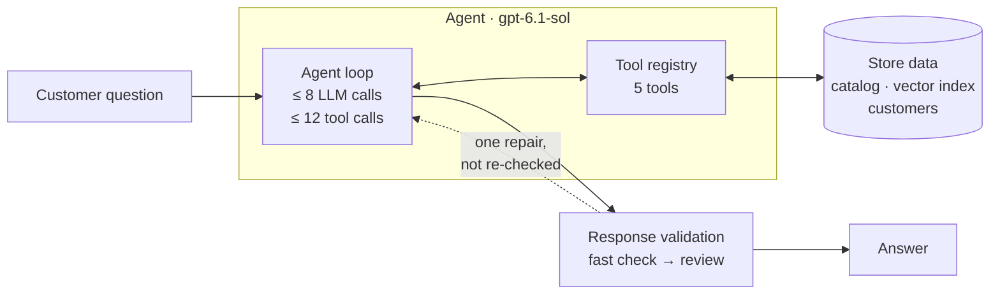
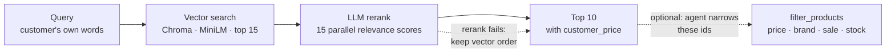
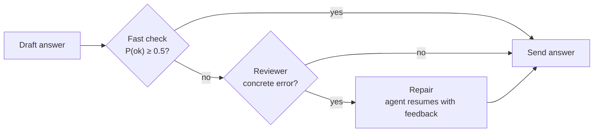

<div align="center">

<h1>🛒 Customer Service Agent</h1>

**An AI shopping agent that grounds every answer in the catalog and checks itself before replying.**


</div>

---

## Overview

The agent answers free-text questions from shoppers, such as *"a scale under $100 that shows pounds and kilograms"* or *"will this purchase make me a premier member?"*. The questions are about a Walmart product catalog, and everything goes through one function: `answer_question(question) -> str`.

**How it answers:**
1. A tool-calling loop on `gpt-6.1-sol` picks from five tools: product search, product filters, customer lookup, sign-in and a calculator.
2. It feeds each tool result back to the model until the model can answer.
3. A fast LLM check scores the answer.
4. A doubtful answer goes to an LLM reviewer. If the reviewer confirms an error, the agent gets one chance to fix it.

It is part of a university project on agentic RAG.

**Key design points:**

- **Grounded.**
  - Product facts come only from the catalog.
  - Prices are computed in code, not by the model.
- **Tamper-proof pricing.** Only a verified premier sign-in turns on the 5% discount. The model can't grant the discount itself.
- **Hybrid retrieval.** Vector search plus an LLM rerank handle meaning. Exact filters handle price, brand and stock.
- **Bounded.**
  - Each question gets at most 8 agent calls and 12 tool calls.
  - The last agent call is kept for the answer, so a question always ends with a reply.
- **Never crashes.**
  - Tools return errors as data, so the model can fix its own arguments.
  - `answer_question` never raises.

| Layer | Stack |
|---|---|
| **Agent** | OpenAI Responses API · `gpt-6.1-sol` · function calling |
| **Rerank & fast check** | OpenAI Decisions API · `gpt-6-luna` · a probability for each answer |
| **Reviewer** | OpenAI Responses API · `gpt-6-luna` · structured output (pydantic) |
| **Retrieval** | ChromaDB (cosine HNSW) · `all-MiniLM-L6-v2` embeddings, run locally |
| **Data** | Pydantic v2 · mongomock (pymongo API) · Walmart product dataset from Kaggle |

---

## Architecture



---

## Agent & tools

| Tool | What it does |
|---|---|
| `authenticate` | Checks email and password, then marks the session premier or regular |
| `get_customer` | Looks up a customer by email or name. Returns only their name and product interests (for gift ideas) |
| `search_products` | Semantic product search: retrieve, rerank, return the top 10 |
| `filter_products` | Exact constraints combined with AND: price range, brand, name, on sale, in stock, or a list of ids |
| `calculator` | Safe arithmetic, parsed from the syntax tree with no `eval`. Rounds half-up with `Decimal` |

### Design decisions

- **Lazy loading.**
  - `import hw4` loads nothing heavy, because the runtime is imported inside `answer_question`.
  - The catalog, the vector index and the OpenAI clients are built on the first question.
  - A test imports `hw4` in a clean subprocess and checks that chromadb, openai and the tools did not load.
- **Built once, kept in memory.**
  - The runtime is cached with `functools.cache`. Later questions reuse the catalog, the in-memory customer store and the clients, so only the first question pays the startup cost.
  - A failed build is not cached, so the next question tries again.
  - The vector index is saved to disk under a hash of its content. A restart skips re-embedding, and a changed catalog gets a fresh index.
  - The only thing created per question is the session.
- **Decisions API: probabilities instead of free text.**
  - **Rerank:** each product gets a *predicate* question ("does it meet the need?"). Products are sorted by the probability that comes back.
  - **Fast check:** one *choice* question with 4 labels (ok, unsuitable products, too many products, question not answered). The answer passes when P(ok) ≥ 0.5.
  - **Why:** the code gets numbers instead of text to parse, so the thresholds are easy to tune. The most likely problem label is handed to the reviewer as a hint.

---

## Product search



- **Retrieve cheaply, judge precisely.**
  - A local embedding model finds 15 candidates at no API cost.
  - Each candidate is scored by the probability that it meets the need.
  - All 15 scoring calls run in parallel, so a search takes about as long as one call.
- **Meaning and exact rules stay apart.** Embeddings handle price and brand poorly, so `filter_products` handles them. It takes the ids from the search results and keeps their relevance order.
- **Embedding text built for a small model.**
  - The Walmart disclaimer is removed first; it appears in 783 of 787 descriptions.
  - The text is ordered name → category → description, because MiniLM cuts off long input.

---

## Response validation



- **Fast gate, careful judge.**
  - An answer that passes costs one extra fast call.
  - The reviewer sees *every* product that was retrieved, so it can catch a better match the agent skipped.
- **The agent fixes the answer; the reviewer only diagnoses.** The repair continues the agent's own run, with its tools, session and remaining budget.
- **Fails open.** If validation hits an error, the original answer is kept. Runs that hit the budget skip validation, because no budget is left to repair them.

---

## Project structure

```
hw4.py                        # entry point: answer_question(question) -> str
run_example_queries.py        # runs sample questions from example_queries.txt
orchestration/
  entrypoint.py               # answer_question: never raises, logs every run
  runtime.py                  # builds data + OpenAI clients once, runs agent → validation
  logger.py                   # per-question trace in agent.log
  main_agent/
    agent.py                  # tool-calling loop with call budgets
    prompt.py                 # system prompt
    tool_registry.py          # binds tools to data, validates arguments, never raises
  response_validator/
    fast_validator.py         # fast LLM check that scores the answer
    reviewer.py               # LLM reviewer for doubtful answers
    pipeline.py               # fast check → review → one repair, fails open
tools/                        # authenticate, get_customer, calculator, filter_products
  search_products/            # vector retrieval + LLM rerank
pricing/                      # per-question session and customer_price
data_init/                    # catalog loading, Chroma index, customer store
assignment_prep/              # dataset download and checks
tests/                        # pytest suite with fake OpenAI clients
```

---

<details>
<summary><b>Getting started</b></summary>

**Requirements:** Python 3.10+ and an OpenAI API key. Set it as both `OPENAI_API_KEY_AGENT` and `OPENAI_API_KEY_DECISIONS`; you can use two different keys if you want separate billing.

```sh
python -m venv .venv && source .venv/bin/activate
pip install -r requirements.txt

python assignment_prep/fetch_product_data.py   # download and curate the product catalog
python assignment_prep/prepare_dataset.py      # check that the data files are ready

cat > .env <<'EOF'
OPENAI_API_KEY_AGENT=sk-...
OPENAI_API_KEY_DECISIONS=sk-...
EOF

python hw4.py "Which scales under \$100 show both pounds and kilograms?"
python run_example_queries.py q3 q10           # run sample queries from example_queries.txt by id
pytest
```

- **First run.** It downloads the MiniLM model and builds the index into `chroma_data/`. Later runs reuse the index.
- **Tests.** The tests never call OpenAI, but some of them need `product_data.csv` and the embedding model.

</details>

---

<div align="center">

Built by **Shachar Ben Zur** · [GitHub](https://github.com/shachar-bz)

</div>
